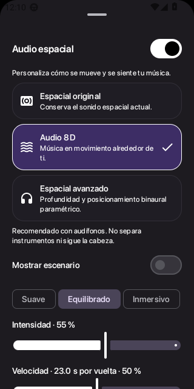
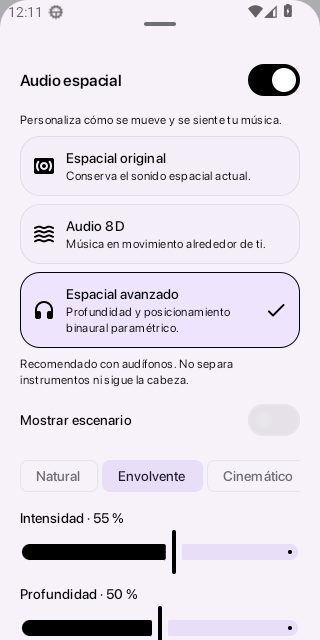
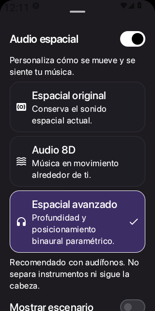

# Space Music 2.4.0: informe de candidata

Estado: **implementación y CI aprobados; publicación bloqueada por firma original**.
No hay una Release 2.4.0 ni un APK oficial nuevo descargable. La última Release
comprobada sigue siendo [v2.3.0](https://github.com/nexlibre/Space-Music/releases/tag/v2.3.0).
Versión de la candidata: 2.4.0, versionCode 8; paquete `org.nexlibre.spacemusic`.

## Fuentes y resultados comprobados

Código probado: `adbf18eed17e7810428862ee36327c4ec56ebe4f`.
[CI 39343912959](https://github.com/nexlibre/Space-Music/actions/runs/39343912959):
conclusión **success**, incluidos los siete trabajos. Regresión JVM de app/shared,
lint, APK de depuración, APK optimizado y ambos ejecutores de pruebas aprobados.
El flujo volvió a compilar las fuentes actuales; no reutilizó un APK fijado de otra versión.
Este informe y las capturas se añaden después; no modifican código, pruebas ni entradas de compilación.

| Entorno | APK | Resultado |
| --- | --- | --- |
| Android 12 / API 31 | Optimizado | 18 pruebas instrumentadas aprobadas; navegación y panel espacial aprobados |
| Android 13 / API 33 | Optimizado | 18 pruebas instrumentadas aprobadas; navegación y panel espacial aprobados |
| Android 14 / API 34 | Optimizado | 18 pruebas instrumentadas aprobadas; navegación y panel espacial aprobados |
| Android 15 / API 35 | Optimizado | 18 pruebas instrumentadas aprobadas; navegación y panel espacial aprobados |
| Android 16 / API 36 | Optimizado | 18 pruebas instrumentadas aprobadas; navegación y panel espacial aprobados |
| Android 13 / API 33 | Depuración | 18 pruebas instrumentadas y comprobaciones de interfaz aprobadas |

Son 18 pruebas repetidas en seis entornos, no 108 pruebas distintas. Los guiones
adicionales verificaron navegación, listas, selección accesible, persistencia tras
recreación, veinte arranques en frío por entorno y los tres modos en claro/oscuro
con fuente normal y al 150 %. Se inspeccionaron también las capturas del panel.
El tema oscuro existente utiliza fondo negro; no se midió un panel AMOLED físico.

Cobertura espacial: parámetros inválidos, límites, periodos, perfiles independientes,
señales sinusoidales/ruido/impulsos/DC a 8–192 kHz, continuidad de cambios, bypass,
retorno exacto al resultado original tras asentarse, retardos y energía contralateral,
EQ/filtro de transición/normalización, persistencia real Android y recuperación de
JSON o tipo corrupto. La migración conserva la habilitación anterior y elige Original.

Reproducción de MP3, FLAC, AAC/M4A y OGG estéreo de 48 kHz con los tres modos,
observando pista, posición y discontinuidades. La prueba espera posición >=1 s
antes de cambiar modos; admite hasta 50 ms de corrección del reloj remoto.
Android 16 aprobó esta comprobación. WAV mono y reproducción local también tienen
cobertura del servicio; mono/multicanal no se espacializan. Las señales técnicas
no sustituyen una evaluación perceptual con música y audífonos.

Lint aprobó con la línea base preexistente: 628 advertencias, 5 sugerencias y
166 hallazgos filtrados. La deuda heredada **no está resuelta**; está descrita en
[la revisión de la línea base](../LINT-BASELINE.md). No se desactivó lint ni se
amplió esa línea base para aceptar errores nuevos de esta función.

## Arquitectura y modos

Se mantiene Media3/ExoPlayer → PrecisionAudioSink Float32 → espacial → EQ →
transición → normalización/limitador → AudioTrack. Cada reproductor del crossfade
conserva su propio estado DSP y recibe la misma instantánea de preferencias.
No se sustituyó el motor ni se modifican los archivos musicales.

- **Espacial original:** conserva las ecuaciones y coeficientes anteriores: amplitud
  2,5, ganancia 0,82, crossfeed 0,2, paso bajo 0,3 y retardo de 15 ms. La salida en
  régimen estable es la original. Activar/desactivar incorpora una rampa suave.
- **Audio 8D:** órbita simulada con diferencias de nivel, profundidad frontal/posterior
  y reverberación amortiguada. Velocidad 0–100 % corresponde a 40–6 s por vuelta.
- **Espacial avanzado:** modelo binaural paramétrico con dos fuentes virtuales estéreo,
  ITD fraccional 0,15–0,65 ms, diferencias de nivel, sombra espectral y distancia.
  No utiliza HRTF medida, separación instrumental ni seguimiento de cabeza.

Perfiles independientes, controles contextuales, restablecimiento por modo y esquema
estático opcional. Las rutas y parámetros se suavizan con constante de 30 ms.
El procesamiento se suspende para Atmos. Se recomiendan audífonos sin bloquear altavoces.
Se conservan licencias y créditos; no se añadieron bibliotecas ni datos HRTF externos.

Se evaluaron [Steam Audio](https://github.com/ValveSoftware/steam-audio), con soporte
Android, HRTF y licencia Apache-2.0, y [OpenAL Soft](https://github.com/kcat/openal-soft),
con Android/HRTF y licencia LGPL, además de sus avisos de datos y terceros. Son opciones
técnicamente posibles para una futura integración nativa. Adaptación de bloques,
ABIs, coste y licencia del paquete completo requieren validación adicional; no se
presenta esa integración como imposible ni como ya implementada. La candidata usa
la alternativa paramétrica descrita, cuyas propiedades técnicas sí se probaron.

## Rendimiento medido

Prueba `SpatialRuntimeTest` en emuladores x86_64: 480.256 frames estéreo a 48 kHz,
aproximadamente 10,005 s de señal, tras calentamiento. Tiempo de CPU del hilo medido
con `Debug.threadCpuTimeNanos`; incluye copia de entrada y comprobación de finitud.
Es una ejecución diagnóstica por modo, no una mediana estadística ni una medida de
batería, latencia física o consumo total de la aplicación.

| API | Bypass (ms) | Original (ms) | Audio 8D (ms) | Avanzado (ms) |
| --- | ---: | ---: | ---: | ---: |
| 31 | 9,11 | 9,87 | 46,51 | 47,76 |
| 33 | 10,70 | 12,62 | 26,11 | 23,88 |
| 34 | 9,60 | 10,26 | 46,38 | 42,85 |
| 35 | 19,07 | 18,96 | 42,32 | 39,70 |
| 36 | 20,18 | 22,63 | 58,11 | 47,31 |

Todos pasaron el presupuesto inicial de 2.500 ms de CPU por ~10 s de señal.
La variación entre emuladores impide atribuir mejoras porcentuales. Original y
bypass son comparaciones del mismo APK; no se midió antes/después el consumo total
contra el APK 2.3.0.

Los registros contienen `heapBefore`/`heapAfter` de cada prueba. En intervalos
individuales se observaron incrementos de hasta 139.296 bytes y una recolección
que redujo el heap en API 36. Son instantáneas del proceso, no memoria exclusiva
del DSP ni una prueba de ausencia de fugas. Quedan pendientes sesiones largas,
memoria nativa, CPU del conjunto, batería y temperatura en dispositivos reales.

Los cinco ZIP de diagnóstico se descargaron y verificaron contra sus digest SHA-256
de Actions. Los informes y capturas están en los artefactos de la ejecución indicada.
Esto no equivale a verificar el hash o la firma de un APK oficial aún inexistente.

## Firma, instalación y publicación

La CI firmó app y ejecutor con una identidad desechable solo para instalar y probar
el código optimizado en emuladores aislados. Esa firma no se presenta como oficial
ni permite actualizar la instalación publicada del usuario.

La [comprobación de firma 39342616316](https://github.com/nexlibre/Space-Music/actions/runs/39342616316)
se ejecutó nuevamente y volvió a confirmar que `SPACE_KEYSTORE_B64` y/o
`SPACE_KEYSTORE_PASSWORD` no están disponibles. El respaldo CMS del repositorio
está cifrado; no se encontró un respaldo utilizable en los archivos accesibles.
No se generó una clave sustituta de publicación ni se reutilizaron firmas antiguas.

Debe restaurarse el almacén **original**, alias `space-music`, mediante los secretos
del repositorio. La huella requerida del certificado es:

`5436f4210119058a215c0b0660dead0a9b1bed315f13d6f801645c71c942c5ce`

Pendientes: firmar el APK final con esa identidad, comprobar su hash y alineación,
verificar paquete/versión/certificado, instalar sobre 2.3.0 sin desinstalar, comprobar
conservación de datos y reproducción, revisar logs y entonces decidir la publicación.
No se creó etiqueta ni Release 2.4.0 y no se cambió el enlace al APK estable.

## Comprobaciones físicas y perceptuales pendientes

No se ha realizado ninguna en esta sesión. Usar el APK oficial firmado cuando esté
listo y registrar modelo, versión Android, salida y canción de prueba:

1. Actualizar sobre 2.3.0 conservando listas, habilitación espacial y preferencias.
2. Escuchar música propia en los seis perfiles, comparando voces, graves, balance,
   fatiga, distorsión y volumen con Original y bypass a volumen moderado.
3. Cambiar modos/controles y activar/desactivar durante una canción y durante crossfade;
   comprobar chasquidos, posición, pausa/reanudación e interacción con EQ/normalización.
4. Probar cable, Bluetooth y altavoz; conectar/desconectar y cambiar salida reproduciendo.
5. Comprobar llamadas, notificaciones, bloqueo de pantalla y reproducción en segundo plano.
6. Repetir al menos 30 minutos con otra aplicación abierta; registrar CPU, memoria,
   batería, temperatura y posibles fallos. Probar archivos y tasas adicionales reales.
7. Revisar TalkBack, contraste, fuentes mayores, pantallas pequeñas y reducción de movimiento.

Limitaciones restantes: aproximación paramétrica sin HRTF medida; solo estéreo;
esquema estático; interacción con efectos externos del dispositivo sin validar.
La ruta original conserva su headroom histórico: EQ extremo sin normalización puede
saturar. No hay promesa bit-perfect con DSP activo. Las pruebas aprobadas no garantizan
ausencia de errores fuera de lo comprobado ni validación auditiva completa.

## Capturas de la candidata comprobada

